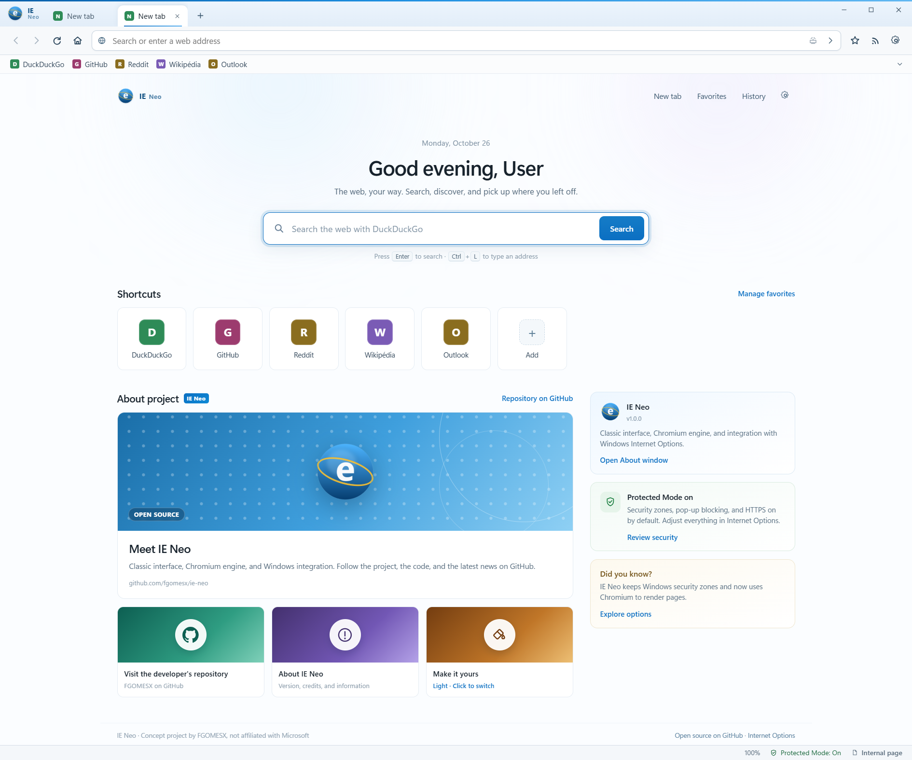

<p align="center">
  
</p>

# IE Neo

Uma releitura do Internet Explorer de como seria nos dias atuais, a identidade e as
**Opções da Internet** do Windows, com interface Fluent no estilo Windows 11,
rodando sobre o **Chromium** de verdade.

<p align="center">
  
</p>

<p align="center">
  <sub>A nova guia: atalhos, widgets do projeto e o alternador de tema.</sub>
</p>

---

## Propriedades

| | |
|---|---|
| Versão | `1.0.0` |
| Motor | Electron `45.0.0` · Chromium `156.0.8078.48` · Node `24` |
| Interface | HTML, CSS e JavaScript puro, sem framework |
| Idioma | Inglês dos Estados Unidos (`en-US`, padrão) e Português do Brasil (`pt-BR`) |
| Plataforma-alvo | Windows 10/11 (integração com o Registro e painéis do Windows) |

---

## O que funciona

### Navegador

- **Abas** com nova guia, fechar, reabrir (`Ctrl+Shift+T`), alternar (`Ctrl+Tab`) e
  **InPrivate** (`Ctrl+Shift+P`) em partição de sessão descartável.
- **Leitor de feeds RSS/Atom** integrado (`Alt+J`), usando a mesma sessão de rede
  do navegador.
- **Barra de status** com zona de segurança, Modo Protegido e estado de carregamento.
- **Temas Claro, Escuro e Sistema**, com o modo Sistema acompanhando automaticamente
  o modo claro/escuro do Windows em todo o navegador e na nova guia.
- **Barra de informações** para pop-ups bloqueados, sessões InPrivate e avisos.
- **Bloqueio de pop-ups**, prompts de permissão (localização, câmera, microfone e
  notificações), DNT/GPC e filtragem real de cookies.
- **Protocolo interno `ie://`** para páginas e dados do próprio navegador.
- Atalhos no padrão do Windows: `Ctrl+T`, `Ctrl+W`, `Ctrl+L`, `Ctrl+D`, `Ctrl+H`,
  `Ctrl+J`, `Ctrl+F`, `Ctrl+P`, `Ctrl+1…9`, `Alt+←/→`, `F5`, `F12`, entre outros.

### Opções da Internet

As sete seções clássicas do `inetcpl.cpl` foram reconstruídas e **alteram o
comportamento real** do navegador:

| Seção | O que controla |
|---|---|
| **Geral** | Página inicial, comportamento ao iniciar, provedor e URL de pesquisa, pasta de downloads, histórico, tema (Claro/Escuro/Sistema), aparência, zoom e idioma. |
| **Segurança** | Zonas Internet, Intranet local, Sites confiáveis e Sites restritos; níveis de segurança, sites por zona, Modo Protegido, HTTPS obrigatório e compatibilidade. |
| **Privacidade** | Nível global de cookies (seis níveis), regras por site (permitir/bloquear/sessão), bloqueador de pop-ups, DNT/GPC e permissões de sites. |
| **Conteúdo** | Descoberta de feeds RSS/Atom, AutoCompletar e acesso ao Gerenciador de Certificados do Windows. |
| **Conexões** | Detecção automática, proxy fixo, script PAC, exceções, teste de conexão e diagnóstico de rede (adaptador, DNS, TCP, proxy e zona). |
| **Programas** | Registro como navegador padrão, atalhos para aplicativos padrão do Windows e complementos internos. |
| **Avançado** | Imagens, animações, sons, JavaScript, barras, sugestões, agente de usuário (IE Neo/IE11/Edge/personalizado), sites de compatibilidade, HTTP/3, DoH, TLS legado e DevTools. |

---

## Integração com o Windows

A integração é feita por `reg.exe` e pelos painéis nativos do Windows, sempre no
escopo do usuário atual (`HKCU`). Nenhuma chave de máquina (`HKLM`) é alterada.

### Registro

| Chave | Valores | Comportamento |
|---|---|---|
| `HKCU\Software\Microsoft\Internet Explorer\Main` | `Start Page`, `Search Page`, `Default_Page_URL` | Lidos na primeira execução; `Start Page`/`Default_Page_URL` só são gravados quando a página inicial é um endereço http(s). |
| `HKCU\Software\Microsoft\Windows\CurrentVersion\Internet Settings` | `ProxyEnable`, `ProxyServer`, `ProxyOverride`, `AutoConfigURL`, `AutoDetect` | Lidos na primeira execução e sincronizados ao aplicar Conexões. |

Na primeira execução, se o Windows já tiver uma página inicial personalizada ou um
proxy configurado, o IE Neo importa esses valores — exceto a página inicial padrão
da Microsoft, para preservar `ie://newtab`. Depois disso, o arquivo local de
preferências passa a ser a fonte da verdade, e o Registro é espelhado a cada
aplicação. Quando a página inicial é interna (`ie://newtab`), `Start Page` e
`Default_Page_URL` mantêm o valor já existente, pois o Windows espera uma URL da web.

### Painéis e ferramentas nativas

- **Opções da Internet clássica** — `rundll32.exe shell32.dll,Control_RunDLL inetcpl.cpl`
- **Gerenciador de Certificados** — `certmgr.msc`
- **Editor do Registro** — `regedt32.exe`
- **Configurações do Windows** — páginas `ms-settings:` para aplicativos padrão,
  conexões discadas e privacidade.

O botão “Definir como navegador padrão” registra os protocolos `http` e `https` e
abre as Configurações do Windows. O Windows 11 exige a confirmação manual do
usuário; o aplicativo não tenta contornar essa proteção.

---

## Como executar

### Requisitos

- Windows 10 ou 11 (a integração com o Registro é específica do Windows).
- **Node.js 20 ou superior** (testado com Node 24).
- npm.
- Conexão com a internet para a primeira instalação das dependências.

### Instalação

```powershell
git clone https://github.com/fgomesx/ie-neo.git
cd ie-neo
npm install
npm start
```

Para abrir com logs do processo principal:

```powershell
npm run start:debug
```

> O Electron é baixado pelo npm na primeira instalação. Se a rede corporativa
> bloquear o download, configure o proxy do npm ou use um mirror do Electron.

### Instalador para Windows

```powershell
npm install
npm run dist
```

O instalador é gerado em `dist/IE-Neo-Setup-<versão>.exe` (x64, Windows 10/11).
Durante a instalação, a tela de idioma define **inglês (Estados Unidos)** ou
**português (Brasil)**; essa escolha vira o idioma inicial do navegador no
primeiro uso. A instalação é por usuário (não exige privilégios de administrador)
e pode ser desfeita pelo app **IE Neo** em *Configurações › Aplicativos*.

> O instalador não é assinado digitalmente. Na primeira execução, o Windows
> SmartScreen pode exibir um aviso; use **Mais informações › Executar assim mesmo**.

Para gerar apenas a pasta descompactada, sem instalador:

```powershell
npm run pack
```

---

## Scripts

| Comando | O que faz |
|---|---|
| `npm start` | Abre o navegador. |
| `npm run start:debug` | Abre com o modo `--dev` e logs extras. |
| `npm run shot` | Gera capturas em `shots/` e falha se houver erro de console interno. |
| `npm run smoke` | Teste funcional com Playwright: nova guia, Opções, aplicar/restaurar, idioma (en-US ↔ pt-BR), Registro, zonas, cookies, diagnóstico, filtro Avançado, histórico e links internos. |
| `npm run icon` | Regenera `assets/icon.png`, a cópia usada pela interface e `assets/icon.ico` (requer Python 3 e Pillow). |
| `npm run dist` | Gera o instalador NSIS em `dist/` (Windows x64). |
| `npm run pack` | Gera apenas a pasta `dist/win-unpacked/`, sem instalador. |

As capturas usam o tema **Claro** por padrão. Para gerar também a versão escura,
use `IENEO_SHOT_THEME=dark npm run shot` (os arquivos recebem o prefixo `dark-`).
`IENEO_SHOT_THEME=system` produz o conjunto conforme o modo atual do Windows.

`shot` e `smoke` usam um **perfil temporário isolado** via `IENEO_USER_DATA`, então
não alteram suas preferências reais. O `smoke` grava valores no `HKCU` para validar
a integração e os restaura em `finally`; ainda assim, evite executá-lo em uma
máquina com políticas de Registro gerenciadas.

---

## Dados e redefinição

As preferências ficam em:

```text
%APPDATA%\IE Neo\internet-explorer.json
```

O caminho exato é `app.getPath('userData')` e aparece no rodapé das Opções. O
arquivo guarda configurações, favoritos, histórico, downloads e a última sessão.
As gravações são atômicas (arquivo temporário + renomeação).

Na primeira execução após a renomeação para **IE Neo**, o arquivo
`internet-explorer.json` dos perfis anteriores (`%APPDATA%\IE Neo`
e `%APPDATA%\Internet Explorer`) é copiado automaticamente, preservando favoritos,
histórico e configurações. O primeiro perfil encontrado tem prioridade e os
diretórios antigos não são apagados.

Para redefinir tudo:

1. Feche o navegador.
2. Apague `internet-explorer.json`.
3. Abra o IE Neo novamente. A primeira execução importa página inicial e proxy do
   Windows e recria os padrões.

Também é possível usar **Restaurar avançado** nas Opções ou exportar/importar um
JSON antes de redefinir.

---

## Arquitetura

```text
┌──────────────────────────── Electron main ────────────────────────────┐
│ main.js   janelas · IPC · ie:// · downloads · diagnóstico             │
│ config.js preferências em JSON                                        │
│ network.js cookies · DNT · HTTPS · permissões · proxy                 │
│ registry.js HKCU · inetcpl.cpl · certmgr.msc · regedt32.exe           │
│ zones.js  classificação de URLs e níveis das zonas                    │
└───────────────▲───────────────────────────────▲───────────────────────┘
                │ contextBridge                 │ contextBridge
┌───────────────┴──────────────┐  ┌─────────────┴───────────────────────┐
│ Chrome do navegador          │  │ Opções da Internet                  │
│ abas · omnibox · painéis     │  │ 7 seções · modais · aplicar         │
│ <webview> persist:ie         │  └─────────────────────────────────────┘
│ <webview> ie-inprivate       │
└───────────────┬──────────────┘
                │
        Chromium 156 (Blink, rede, sandbox)
```

- O navegador usa `<webview>` com a partição persistente `persist:ie`; o modo
  InPrivate usa a partição em memória `ie-inprivate`.
- O protocolo privilegiado `ie://` serve a nova guia e dados internos. Ele é
  registrado nas duas sessões para funcionar também em InPrivate.
- Preloads expõem apenas APIs específicas via `contextBridge`; o renderer não tem
  acesso direto ao Node.
- As Opções rodam em uma janela separada e trabalham sobre um **rascunho**. Nada é
  aplicado até “Aplicar”; “Cancelar” descarta e fecha.
- Proxy, cookies, DNT, HTTPS e permissões são aplicados nas sessões do Chromium,
  não simulados na interface.

---

## Limites e decisões de projeto

- **Não é o Internet Explorer clássico.** A renderização é Blink/Chromium. O Modo
  de Compatibilidade envia agente de usuário do IE11 e ajusta recursos, mas não
  executa ActiveX, comportamentos MSHTML ou páginas que dependem exclusivamente do
  Trident.
- **Zonas de segurança são uma camada do IE Neo.** Elas classificam URLs e controlam
  cookies, permissões, HTTPS e agente de usuário no Chromium. Não substituem os
  níveis de integridade do Windows.
- **Modo Protegido** usa o sandbox e as políticas de sessão do Chromium. O rótulo e
  o comportamento são inspirados no IE, mas não replicam o token de integridade
  baixa do Windows.
- **SmartScreen e classificação PICS** não são reimplementados. As proteções
  nativas do Windows/Chromium continuam valendo, e o painel de Conteúdo informa isso
  ao usuário.
- A página de nova guia reúne atalhos, retomada do histórico e conteúdo do projeto
  (repositório, perfil do desenvolvedor e janela “Sobre o IE Neo”). Os cartões abrem
  o GitHub ou as janelas internas do navegador; não há feed de notícias ao vivo.
- O campo “Editor HTML” é informativo. Associações de arquivos e protocolos são
  responsabilidade do Windows.
- A aparência é uma interpretação moderna, não uma réplica pixel a pixel do IE6/IE11.
- O projeto foi validado em Windows 11 com Node 24 e Electron 45. Outras versões de
  Windows devem funcionar, mas a integração com `reg.exe` e `ms-settings:` pode
  variar.
- O idioma está disponível somente Inglês (US) e Português (BR).

---

## Licença

MIT. Consulte [LICENSE](LICENSE).

> Nota: este é um **Projeto conceitual e de fã.** O IE Neo não é um produto da
> Microsoft e não é afiliado, patrocinado ou endossado por ela. “Internet Explorer”
> e “Windows” são marcas da Microsoft, usadas aqui apenas para fins conceituais,
> educacionais e para descrever a compatibilidade. Este repositório não contém
> código proprietário do Internet Explorer clássico.

---

## Créditos

Idealizado e desenvolvido por **[FGOMESX](https://github.com/fgomesx)**, com o auxílio de IA.

Feito com ❤️.
